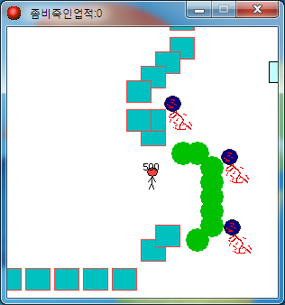

# Crazy Zombie Defense 2

[한국어](README.ko.md)

The sequel to [Crazy Zombie Defense](https://github.com/wnsrn3436/game-crazy-zombie-defense). It adds an item system: pick up the sword lying on the field or earn the gun by killing zombies, and the weapon tags along behind the character.

  

## How to play

Download from Releases and run it.

Move with the arrow keys. Pick up the sword lying on the field and it follows you around; press space to slash with it. After 10 zombie kills you get a gun, which fires with the left mouse button. Keys 1 and 2 bring the sword and gun out or put them away. The zombie kill count is shown in the window title bar.

## How it works

The weapon follows the player by moving toward the player's coordinates at speed 5 each step. It does not use anything like a parent-child relationship, just a single move toward point action in the Step event. That is why the weapon trails a little behind the character instead of sticking right to it.

The zombie kill count reuses the `health` value unchanged; in Crazy Zombie Defense it counted buildings. Each kill raises the value, and the title bar shows it with the label "좀비죽인업적".

## Files

| Path | Contents |
|---|---|
| `source/crazy-zombie-defense-2.gmk` | Original project file |
| `source/split/` | Text tree produced by GmkSplitter |
| `docs/screenshots/` | Screenshots |
| Releases | Distributed build |

## License

CC BY-NC-ND 4.0. Unmodified copies may be shared for noncommercial purposes with attribution. Distributing modified versions and commercial use are not allowed. Bundled libraries, graphics, sounds, and maps made by other people keep their own rights. See [LICENSE](LICENSE).
